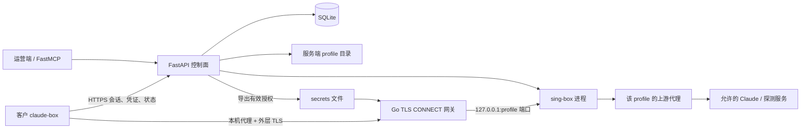

# 项目架构与路径导览

本文按**当前仓库代码**说明项目如何组成、请求如何流转、文件放在哪里，以及遇到需求或故障时应从哪里读起。文中的路径除特别说明外，均相对于仓库根目录；本机工作区示例为 `E:\Codes\claude-cluster-engine`。运行命令中的相对路径也以仓库根目录为基准。

## 1. 先理解项目在做什么

`claude-cluster-engine` 把一个 Claude 账号表示为一个 **profile**：它关联固定的预期出口 IP、上游代理、服务器本地代理端口、浏览器指纹、凭证和状态。运营端负责创建和维护 profile，再给客户签发有期限的 `card_key` 与独立的 `tunnel_secret`。客户通过 `claude-box` 启动 CLI 或桌面浏览器。

项目由四个主要运行单元组成：

| 运行单元 | 代码入口 | 主要职责 |
| --- | --- | --- |
| Python 控制面 | `server/api/app.py` | 提供管理和客户会话 API，操作 SQLite，管理 profile、登录凭证、sing-box 和状态。 |
| Go 网关 | `gateway/main.go` | 接受客户的外层 TLS 连接，校验 CONNECT 凭据和目标域名，将流量导向对应的本地 sing-box 端口。 |
| sing-box | 外部程序；由 `server/core/singbox_manager.py` 管理 | 每个 profile 一个仅监听服务器 `127.0.0.1` 的入口，再经该 profile 的上游代理出网。 |
| Go 客户端 `claude-box` | `client-launcher/main.go` | 领取会话、检查出口 IP、获取凭证、启动 Claude CLI 或 Camoufox 浏览器，并向控制面报告结果。 |

`server/mcp_server.py` 另提供 FastMCP 管理入口，调用与 HTTP 管理面相同领域的服务和数据库。它有自己的服务实例与数据库连接；不要把它理解为 FastAPI 进程中的一个 HTTP 路由。

### 两条路径

**控制路径**：运营端或 MCP 创建 profile、签发 key；客户通过 HTTPS 请求 `/launcher/session`，随后获取凭证、发心跳、报告状态。状态落在 SQLite 中，可用的隧道授权被导出为文件，供网关读取。

**数据路径**：Claude CLI／浏览器 → 客户端本机 loopback 代理 → 外层 TLS → Go 网关 → 对应 profile 的 sing-box loopback 端口 → 上游住宅代理 → 允许的目标域名。网关不在每次 CONNECT 时查询控制面数据库。



## 2. 仓库目录与阅读顺序

```text
claude-cluster-engine/
├─ README.md                     项目简介、构建及最小使用示例
├─ SPEC.md                       目标/需求规格；可能包含尚未落地的设想
├─ TASKS.md                      任务记录
├─ Makefile                      Go 跨平台构建、检查和产物命名
├─ pytest.ini                    根目录 pytest 配置
├─ docs/
│  ├─ PROJECT_GUIDE.md           本文：当前实现、路径和数据流
│  ├─ ARCHITECTURE.md            原有设计说明
│  └─ OPERATIONS_SOP.md          运营流程说明
├─ server/
│  ├─ pyproject.toml             Python 包、依赖和开发依赖
│  ├─ api/app.py                 FastAPI 应用及 HTTP 路由
│  ├─ mcp_server.py              FastMCP 工具和知识资源
│  ├─ core/                      profile、浏览器、代理、加密、状态等业务逻辑
│  ├─ db/database.py             SQLite 连接、查询和事务
│  ├─ db/schema.sql              数据表定义
│  └─ util/ids.py                key/token 生成
├─ gateway/
│  ├─ main.go                    TLS CONNECT 网关
│  ├─ main_test.go               网关测试
│  └─ go.mod
├─ client-launcher/
│  ├─ main.go                    claude-box CLI/desktop 实现
│  ├─ main_test.go               启动器测试
│  └─ go.mod
├─ tests/
│  ├─ test_*.py                 Python 单元/API/MCP 测试
│  ├─ conftest.py                测试夹具
│  ├─ e2e/                      使用假控制面、代理和目标站的端到端脚本
│  └─ live.py                   真实网络联调脚本
├─ data/                         运行时生成，Git 忽略
└─ dist/                         make 构建产物，Git 忽略
```

建议第一次读代码按 `server/db/schema.sql` → `server/api/app.py` → `server/core/profile_manager.py` → `server/core/singbox_manager.py` → `gateway/main.go` → `client-launcher/main.go` 的顺序。先明确一个 profile 在库中的形状，再追踪它如何被创建、授权、路由和使用。

## 3. Python 控制面的内部结构

### HTTP 与 MCP 入口

| 路径 | 作用 | 主要关注点 |
| --- | --- | --- |
| `server/api/app.py` | `create_app()` 建 FastAPI，启动时连接数据库、恢复路由、导出授权并启动 cooldown 清理任务；关闭时停止任务和 sing-box。 | 路由鉴权、请求响应、启动恢复、各服务编排。 |
| `server/mcp_server.py` | 用 FastMCP 暴露建批次、建 profile、预检、同步凭证、签发 key、查看 fleet 等工具。 | 运维/编排入口；与 HTTP 共用数据库和导出文件，但服务实例独立。 |
| `server/pyproject.toml` | Python 3.11+ 的项目依赖、可编辑安装和开发依赖。 | 安装失败、依赖升级。 |

HTTP 路由分为三组：

- **健康检查**：`GET /healthz` 只表明应用有响应；`GET /readyz` 检查管理 token、主密钥、隧道主机、授权文件环境变量和 sing-box 可用/运行状态。
- **管理路由**（`/admin/*`）：要求 `x-admin-token`。涉及批次、profile 列表/状态、预检、浏览器隐匿性检查、凭证同步/导入、sing-box 查询/重载、key 签发/撤销及授权文件重导出。
- **客户路由**（`/launcher/*`）：首个 `/launcher/session` 请求需要 `Authorization: Bearer <card_key>` 和 `x-tunnel-secret`；后续凭证、心跳和状态请求还要带返回的 `x-session-id`，且会话仍属于当前 BUSY profile。

管理 API 的具体路径见 `server/api/app.py`，运行后还可以访问 `/docs` 查看 OpenAPI。MCP 工具有 `create_account_batch`、`create_isolated_profile`、`preflight_profile`、`verify_profile_stealth`、`sync_credentials`、`scrub_cache`、`reload_relay`、`issue_customer_card_key`、`fleet_status`；知识资源有 `veynod://knowledge/cluster-spec`、`.../cluster-ops`、`.../cluster-architecture`。

| HTTP 路径 | 做什么 |
| --- | --- |
| `POST /admin/batches`、`POST /admin/profiles` | 建批次、建 profile。 |
| `GET /admin/profiles`、`GET /admin/profiles/{profile_id}` | 查看 profile 列表或单个 profile。 |
| `POST /admin/profiles/{profile_id}/status`、`.../release` | 强制调整状态、释放残留会话。 |
| `POST /admin/profiles/{profile_id}/preflight`、`.../stealth-check` | 核验代理出口、运行浏览器环境检查。 |
| `POST /admin/profiles/{profile_id}/sync-credentials`、`.../import-credentials` | 自动同步或手工导入 Claude 凭证。 |
| `GET /admin/singbox`、`POST /admin/singbox/reload` | 查看和重载本地代理配置。 |
| `POST /admin/keys`、`GET /admin/keys/{profile_id}`、`DELETE /admin/keys/{card_key}` | 签发、查询和撤销交付 key。 |
| `POST /admin/tunnel-secrets` | 强制重新导出网关授权文件。 |
| `POST /launcher/session` | 领取 BUSY 会话，返回 profile 和网关信息。 |
| `GET /launcher/credentials`、`GET /launcher/credentials/b64` | 服务端解密数据库中的凭证，返回 tar.gz；后者以 Base64 JSON 返回，是调试接口。 |
| `POST /launcher/heartbeat` | 汇报实际 IP 并续租当前 BUSY 会话。 |
| `POST /launcher/status` | 报告会话结果并改变状态。 |

### 核心模块

| 文件 | 当前实现负责什么 |
| --- | --- |
| `server/core/profile_manager.py` | 校验批次和端口范围，生成并保存 Camoufox 指纹，为每个 profile 创建 `browser_data`、`claude_home`，按规则清理缓存。端口范围是 `10001`～`11000`。 |
| `server/core/proxy_inspector.py` | 通过 profile 的上游代理访问 IP/地理信息服务，核对 `expected_ip`，保存地理信息；失败时把 profile 标记为 `PROXY_DEAD`。新建 profile 本身不等于完成预检。 |
| `server/core/browser_pool.py` | 限制并发浏览器数，领取浏览器会话，先做代理预检再用 Camoufox 打开持久化上下文；协助 OAuth 登录、收集和封存 Claude 凭证。 |
| `server/core/login.py` | 登录页面自动化辅助，包括同意页面、邮件和验证码相关步骤；遇到需人工处理的步骤时可能停下。 |
| `server/core/singbox_manager.py` | 将 profile 的本地端口与上游代理 URL 组装成 sing-box 配置，写入 `data/singbox/config.json`，重启 sing-box 进程。配置由 Python `render()` 构造。 |
| `server/core/crypto.py` | 用 `CCE_MASTER_KEY` 对凭证包做 AES-GCM 加/解密，profile ID 作为关联数据。 |
| `server/core/lifecycle.py` | profile 状态转换、cooldown 截止时间和到期释放。 |
| `server/core/secret_export.py` | 从数据库导出仍有效的网关授权，原子替换授权文件；让网关能独立完成连接鉴权。 |
| `server/db/database.py` | SQLite 连接、迁移、profile/key/session 读写与原子会话领取。 |
| `server/db/schema.sql` | 三张核心表和索引定义。 |
| `server/util/ids.py` | 生成客户 key 和相关随机标识。 |

### 三张数据库表如何关联

```text
payment_batches.batch_id
        │ 0..n
        ▼
profiles.profile_id ────────────┐
        │ 1..n                   │ 每个 profile 固定一个本地代理端口
        ▼                        │ 和一个预期出口 IP
delivery_keys.card_key           │
  + tunnel_secret                │
  + expires_at / is_active       ┘
```

- `payment_batches` 存批次、BIN 前缀、账单国家及最大账号数。
- `profiles` 是核心实体。保存 `local_proxy_port`、`upstream_proxy_url`、`expected_ip`、`os_type`、`fingerprint_json`、`geo_json`、加密后的 `claude_credentials_enc`、`status`、`active_session_id`、`last_heartbeat_at`、`cooldown_until` 等。上游代理账号保存在服务端，不需要交给客户端。
- `delivery_keys` 将 `card_key` 绑定到 profile，另存 `tunnel_secret`、套餐、到期时间和启用状态。一个 profile 可有多条 key，但 BUSY 状态限制同时领取会话。

SQLite 使用 WAL 和外键。旧库需要的 `active_session_id` 与 `last_heartbeat_at` 字段由 `Database.migrate` 处理；后者补齐时会给遗留的 BUSY 行写入当前时间，避免部署瞬间释放仍在运行的会话。创建新字段或变更状态语义时，应同时检查 `schema.sql`、`database.py`、API 和测试。

## 4. 网络链路、端口与信任边界

### 控制面请求

1. 运营端用管理 token 调用 `/admin/*`，或通过 MCP 工具建立批次/profile、配置出口、导入/同步凭证、签发 key。
2. 控制面把数据写入 SQLite；sing-box 端口映射由数据库中的 profile 恢复或更新；有效 key 授权被写进 `CCE_TUNNEL_SECRETS` 指定的文件。
3. 客户带 `card_key` 和 `tunnel_secret` 请求 `/launcher/session`。数据库原子地把可用的 `IDLE` profile 设为 `BUSY` 并生成 `session_id`，避免两个启动器同时占用同一账号。
4. 控制面返回会话、预期 IP、指纹、地理信息、profile 本地代理端口和网关地址。隧道 secret 由客户本来持有，响应不再下发它。

### 客户流量

1. `claude-box` 在客户机上启动随机 loopback 端口的 CONNECT 代理，并通过 TLS 连到 Go 网关；自签或私有 CA 用客户端的 `CCE_TUNNEL_CA` 信任。
2. 网关读取 CONNECT 的 `Proxy-Authorization`（其中放 `tunnel_secret`）和 `x-profile-port`，按导出文件校验 secret 对应的 profile 端口及到期时间，同时限制 CONNECT 目标域名。`card_key` 用于控制面领取会话；当前网关不读取它。默认允许 Anthropic/Claude 域名和必要的探测/辅助域名；具体规则在 `gateway/main.go` 的 `defaultDomains()`，可用 `--domains` 覆盖。
3. 网关将 CONNECT 接到服务器 `127.0.0.1:<local_proxy_port>` 的 sing-box mixed inbound。sing-box 再经该 profile 的上游 SOCKS/HTTP 代理出网。没有匹配的本地入口时，网关不会直接连接目标站作为回退。
4. 客户端在启动 Claude 前通过隧道探测实际出口 IP，与 `expected_ip` 比较。发生偏移会向控制面报告并阻止继续启动。服务端浏览器流程也会独立做上游代理预检。
5. 网关定期重读授权文件，对已建立连接也检查授权是否被撤销或过期；状态变为不可用时，控制面重导出授权文件。

外层 TLS 在网关终止，网关据此读取 CONNECT 请求；到目标站的内层 TLS 仍由 Claude 客户端与目标站建立。网关做目标域名和 profile 端口控制，不解密 Claude 与目标站的业务 HTTPS 内容。客户端的代理环境变量/浏览器配置是应用级路由方式，并非操作系统级的全局网络隔离。

| 端口/地址 | 谁监听 | 用途 |
| --- | --- | --- |
| 示例 `:8000` | FastAPI/Uvicorn | 控制面 HTTP API；代码未固定监听端口，生产应通过 HTTPS 暴露。 |
| 默认 `:8443` | Go 网关 | 外层 TLS + 已鉴权的 CONNECT；由 `--listen` 配置。 |
| `127.0.0.1:10001`～`11000` | sing-box | 每个 profile 的服务端本地入口，不应直接对客户开放。 |
| 客户机随机 `127.0.0.1` 端口 | `claude-box` | Claude CLI/浏览器使用的本地 CONNECT 代理。 |
| 上游代理的主机和端口 | 外部代理服务 | sing-box 出网出口，取自 profile 的 `upstream_proxy_url`。 |

## 5. 典型业务流程

### A. 建立账号和出口

1. 在 `payment_batches` 创建批次，再创建 profile，填入 `profile_id`、上游代理 URL、`expected_ip`、系统类型和服务端本地端口。
2. `ProfileManager` 生成并保存指纹，创建服务端 profile 目录。它不会仅因创建就证明上游代理可用。
3. 注册 sing-box 路由，部署时需确保 `sing-box` 可执行文件可用并成功重载。API 启动会从现有数据库记录重建路由。
4. 运行 `/admin/profiles/{profile_id}/preflight` 或 MCP `preflight_profile`，确认实际出口 IP 与预期一致，并记录地理信息。失败将进入 `PROXY_DEAD`。

### B. 建立 Claude 凭证

调用 `/admin/profiles/{profile_id}/sync-credentials` 或 MCP `sync_credentials`：服务端在该 profile 的浏览器上下文里处理 `claude auth login`，得到 `.credentials.json` 后打包、加密并写入 `profiles.claude_credentials_enc`。如果自动化登录遇到密码、SSO、二次验证或人工验证码，可用 `/admin/profiles/{profile_id}/import-credentials` 导入已登录的 `.claude` 目录。两条途径最终都使用同一加密存储流程。

### C. 签发与客户启动

管理端签发 key 后，客户获得 `card_key` 和独立的 `tunnel_secret`。`claude-box cli` 或 `claude-box desktop` 先领取会话，再建立隧道并检查出口 IP：

- **CLI**：从控制面下载凭证包，解出到客户机 `~/.claude-box/profiles/<profile_id>/.claude`，设置 `CLAUDE_CONFIG_DIR`、代理环境变量和时区，启动官方 `claude`。退出后按结果报告 `IDLE`、`COOLDOWN` 或 `AUTH_EXPIRED` 等状态；会话期间每 30 秒向控制面发心跳以续租。正常退出、捕获中断信号或异常退出都会无条件删除该 profile 的本地明文目录；每次启动前还会先清掉上次被强杀遗留的明文目录（刚更新过的目录会跳过，见第 10 节）。
- **Desktop**：准备 Camoufox 内核（`--runtime` 或内核下载 URL），使用客户机 `~/.claude-box/profiles/<profile_id>/browser_data`，重放服务端保存的指纹/地理设置，通过本机代理打开 `https://claude.ai`。启动预清理只删除 `.claude`，不动持久化的 `browser_data`。

### D. 撤销、失效与恢复

撤销 key、key 到期、profile 变为不可用状态或出口 IP 漂移，都会影响网关授权。控制面更新数据库并重导出授权文件；网关从文件刷新授权。控制面定时任务（默认检查间隔 30 秒，可配置）同时处理两类残留：`COOLDOWN` 到期后恢复 `IDLE`，以及超过租约阈值（120 秒）没有心跳的 `BUSY` 账号恢复 `IDLE`、清空 `active_session_id` 并重导出授权。因此启动器被强杀或断电时，账号最多在一个租约窗口加一个巡检间隔后自动回归可用；`/admin/profiles/{profile_id}/release` 仍可用于立即手动释放。

## 6. 状态、会话与凭证的区别

| 概念 | 保存位置 | 含义 |
| --- | --- | --- |
| `profile_id` | `profiles` | 账号隔离单元的稳定 ID，也是服务端/客户端目录名的组成部分。 |
| `local_proxy_port` | `profiles` | 该账号在服务器 sing-box 的专属入口；网关按它转发。 |
| `expected_ip` | `profiles` | 运营端登记的固定出口 IP，供预检和启动器探测比对。 |
| `card_key` + `tunnel_secret` | `delivery_keys` / 客户端持有 | 控制面领取会话需要两者；网关 CONNECT 使用 `tunnel_secret`、端口和到期时间，不再校验 `card_key`。key 是否可用还受启用位和 profile 状态约束。 |
| `session_id` | `profiles.active_session_id` / 客户端持有 | 当前 BUSY 会话的标识，用于后续凭证、心跳和状态请求。它不是长期授权 key。 |
| `last_heartbeat_at` | `profiles` | 租约时间戳。领取会话时写入，每次心跳刷新；超过 120 秒未刷新即被定时任务回收。 |
| `claude_credentials_enc` | `profiles` | 服务端加密后的 Claude 凭证包；与隧道认证 secret 不同。 |

| profile 状态 | 语义与常见后续动作 |
| --- | --- |
| `IDLE` | 可领取新的客户/浏览器会话。 |
| `BUSY` | 已被某个 `session_id` 占用并持有心跳租约；正常结束报告回 `IDLE`，心跳中断 120 秒后由定时任务自动释放，异常结束也可转入其他状态。 |
| `COOLDOWN` | 使用节奏限制后的暂休，截止后由定时任务释放。 |
| `AUTH_EXPIRED` | Claude 登录凭证失效，需要重新同步/导入凭证。 |
| `PROXY_DEAD` | 上游代理失败或实际出口 IP 不符合预期，需要修复并复检。 |
| `BANNED` | 账号被标记禁用，需要管理端处理。 |

状态转换由 `server/core/lifecycle.py` 控制，管理接口可显式强制设置。`delivery_keys` 自身的有效期/启用位与 profile 状态是两套不同的条件；任何一套不满足都不能正常交付。

## 7. 运行时文件到底在哪里

以下是默认路径，均可按对应环境变量或运行环境改变。`data/` 和 `dist/` 已列入 `.gitignore`，不会随代码提交。

| 路径 | 产生者 | 内容与注意事项 |
| --- | --- | --- |
| `data/cce.sqlite3` | Python `Database` | 默认 SQLite 主库；`CCE_DB_PATH` 可改。WAL 运行时还可能产生 `-wal`、`-shm` 文件。 |
| `data/cce.secrets` | `secret_export.py` | 默认网关授权导出路径；显式设置 `CCE_TUNNEL_SECRETS` 时使用该路径。含敏感 key/secret，不应提交。 |
| `data/profiles/<profile_id>/browser_data` | `ProfileManager` / 服务端 Camoufox | 服务端浏览器持久化资料。 |
| `data/profiles/<profile_id>/claude_home` | `ProfileManager` / 登录同步流程 | 服务端 Claude 登录配置目录。 |
| `data/singbox/config.json` | `SingBoxManager` | 当前生成的 sing-box 配置，含上游代理连接信息。 |
| `data/gateway/tls.crt`、`data/gateway/tls.key` | Go 网关 | 默认外层 TLS 证书及私钥；缺失时网关可生成自签证书，路径可配置。 |
| `dist/claude-box-<os>-<arch>`、`dist/gateway-<os>-<arch>` | `Makefile` | 跨平台二进制产物，Windows 文件带 `.exe`。 |
| `~/.claude-box/profiles/<profile_id>/.claude` | 客户端 CLI | 客户端临时解密的 Claude 配置/凭证；正常退出与中断都会无条件删除，启动时还会预清理上次残留。Windows 的 `~` 是运行用户的主目录。 |
| `~/.claude-box/profiles/<profile_id>/browser_data` | 客户端 Desktop | 客户端浏览器持久化资料，与服务器上的同名目录不是同一份文件。 |

`secret_export.py` 用临时文件加原子替换更新授权文件。如果网关在容器中读取该文件，应挂载**父目录**，使新文件也可见；只挂载旧文件本身可能在替换后仍读到旧 inode。文件格式与解析逻辑分别在 `server/core/secret_export.py` 和 `gateway/main.go`，变更时须同时更新。

## 8. 配置与启动入口

### 常用环境变量

| 所属进程 | 配置 | 作用/默认值 |
| --- | --- | --- |
| 控制面 | `CCE_DB_PATH` | SQLite 路径，默认 `data/cce.sqlite3`。 |
| 控制面 | `CCE_ADMIN_TOKEN` | `/admin/*` 的管理 token；`/readyz` 要求已设置。 |
| 控制面 | `CCE_MASTER_KEY` | 32 字节密钥的 Base64 文本，用于 AES-GCM 凭证封存；`/readyz` 要求已设置。 |
| 控制面 | `CCE_TUNNEL_HOST` / `CCE_TUNNEL_PORT` | 返回给客户端的网关地址；端口默认 `8443`。 |
| 控制面 / 网关 | `CCE_TUNNEL_SECRETS` | 共享的授权文件路径；网关启动必须配置，控制面的 `/readyz` 也检查该环境变量。 |
| 控制面 | `CCE_REAPER_INTERVAL` | cooldown 与 BUSY 租约的清理间隔，默认 30 秒；`0` 可停用。 |
| 网关 | `CCE_TUNNEL_CERT` / `CCE_TUNNEL_KEY` | 网关 TLS 证书/私钥路径，默认在 `data/gateway/`。 |
| 网关 | `CCE_TUNNEL_SAN` | 自签证书需要覆盖的主机名列表。 |
| 客户端 | `CCE_HOST` / `CCE_TUNNEL_SECRET` | `--host` / `--secret` 的环境变量默认值。 |
| 客户端 | `CCE_GATEWAY` / `CCE_TUNNEL_CA` | 可覆盖网关地址；后者指定额外信任的 PEM CA。 |
| 客户端 Desktop | `CCE_KERNEL_URL` / `CCE_HEADLESS` / `CCE_EXTRA_PREFS` | 内核下载地址、无界面运行、额外 Firefox prefs。 |

客户端使用的 `CCE_TUNNEL_SECRET` 与网关使用的 `CCE_TUNNEL_SECRETS` 是两个不同变量。前者是某个客户的 secret，后者是控制面导出的授权**文件路径**。服务端和网关若运行在不同工作目录或容器里，必须显式设置路径，保证读取同一份文件。

### 本地开发的最短路径

需要 Python 3.11+、Go 1.22+。真实代理路由还需要独立安装 `sing-box`，真实 Desktop 流程需要 Camoufox 内核及其运行资源。

```powershell
# 在仓库根目录（PowerShell）
py -3.11 -m venv .venv
.\.venv\Scripts\python.exe -m pip install -e "server[dev]"
.\.venv\Scripts\python.exe -m pytest -q

Push-Location gateway; go test ./...; Pop-Location
Push-Location client-launcher; go test ./...; Pop-Location
```

部署时先准备管理 token、主密钥、网关地址、共享授权文件和 TLS 证书，再启动控制面和网关。以下仅展示入口，不包含真实密钥或对外暴露配置：

```powershell
# 这些环境变量应在当前 shell 或部署平台中预先设置
.\.venv\Scripts\uvicorn.exe api.app:create_app --factory --host 127.0.0.1 --port 8000

# 在另一个终端；PowerShell 中从 gateway 模块目录构建
New-Item -ItemType Directory -Force dist | Out-Null
Push-Location gateway
go build -o ..\dist\gateway-local.exe .
Pop-Location
.\dist\gateway-local.exe --listen :8443
```

`make all` 在支持 Make/Shell 的环境中构建四个目标平台的客户端和网关；`make check` 执行 Go 格式、vet 和测试；`make dist-check` 检查客户端产物命名和内核 URL 注入。`server/api/app.py` 是 HTTP 入口；FastMCP 入口是 `server/mcp_server.py`，需要按你的 MCP 宿主方式单独启动。

## 9. 测试与改动定位

| 想确认/修改什么 | 从哪里开始 | 对应验证 |
| --- | --- | --- |
| 管理 API、会话鉴权、状态报告、BUSY 租约回收 | `server/api/app.py`、`server/db/database.py`、`server/core/lifecycle.py` | `tests/test_api.py`、`tests/test_lifecycle.py` |
| 批次/profile 创建、指纹和目录 | `server/core/profile_manager.py` | `tests/test_profile_manager.py` |
| 出口 IP、代理故障阻断 | `server/core/proxy_inspector.py` | `tests/test_proxy_killswitch.py` |
| 登录与凭证封存 | `server/core/browser_pool.py`、`server/core/login.py`、`server/core/crypto.py` | `tests/test_login.py`、`tests/test_credential_sync.py`、`tests/test_crypto.py` |
| sing-box 端口映射 | `server/core/singbox_manager.py` | `tests/test_singbox.py` |
| MCP 工具/资源 | `server/mcp_server.py` | `tests/test_mcp.py` |
| 网关域名白名单、隧道授权、端口绑定 | `gateway/main.go`、`server/core/secret_export.py` | `gateway/main_test.go`、`tests/test_api.py` |
| 客户端 CLI/Desktop、凭证提取、状态上报 | `client-launcher/main.go` | `client-launcher/main_test.go`、`tests/e2e/` |
| 与真实代理和 Claude 联调 | `tests/live.py` | 需准备真实上游代理、凭证和外网环境。 |

`tests/e2e/` 的脚本构造假控制面、假中转和 TLS 目标站，可以验证链路而无需真实 Anthropic 账号；`tests/live.py` 才是依赖真实外部服务的联调。修改网关授权格式或状态权限时，要同时考虑 Python 导出端、Go 读取端以及持续连接的撤销行为。

## 10. 当前实现边界与容易误解之处

- `SPEC.md` 是目标规格，判断某功能是否真正存在应以当前代码和测试为准。例如仓库目前没有独立的云端流式分发模块。
- 创建 profile 只建立身份、端口和文件目录；要确认出口健康，需要显式预检或进入会触发预检的浏览器流程。客户端启动还有自己的出口探测。
- `server/config/` 目录已移除，不再有 `singbox_template.json`；当前生效配置全部由 `SingBoxManager.render()` 直接生成。
- 授权文件只保存当前可用的 key。其行包含 `card_key secret expires_at profile_port`，但当前网关解析时以 **secret** 为索引，校验期限和 profile 端口；文件里的 `card_key` 并未参与 CONNECT 校验。网关按导出文件变化撤销连接，不直接感知 SQLite 事务。
- `BUSY` 有服务端租约：领取和心跳刷新 `last_heartbeat_at`，超过 120 秒静默即由定时任务回收为 `IDLE`。客户端每 30 秒心跳一次，因此正常长会话不会被误回收；人工 `/release` 仍可立即释放。代价是客户端若被冻结超过阈值，服务端会把账号交还给下一位客户，而旧进程恢复后其状态报告会因 `session_id` 不匹配而被拒。
- 浏览器登录可能碰到需要人工完成的密码、SSO 或验证码步骤。自动同步失败可走凭证导入流程。
- 服务端凭证密文与客户机运行时解出的明文副本处于不同安全边界。`--keep` 已移除：客户端在退出（含 Ctrl-C）时无条件擦除明文目录，并在每次启动前清理残留。预清理按凭证文件的修改时间判断，最近 30 秒内仍新鲜的目录视为另一个终端正在运行的会话并跳过，因此可以同时开两个不同账号。

更多背景看根目录 `README.md`、设计说明 `docs/ARCHITECTURE.md` 和运行流程 `docs/OPERATIONS_SOP.md`。排查实际行为时先看当前入口文件和测试。
